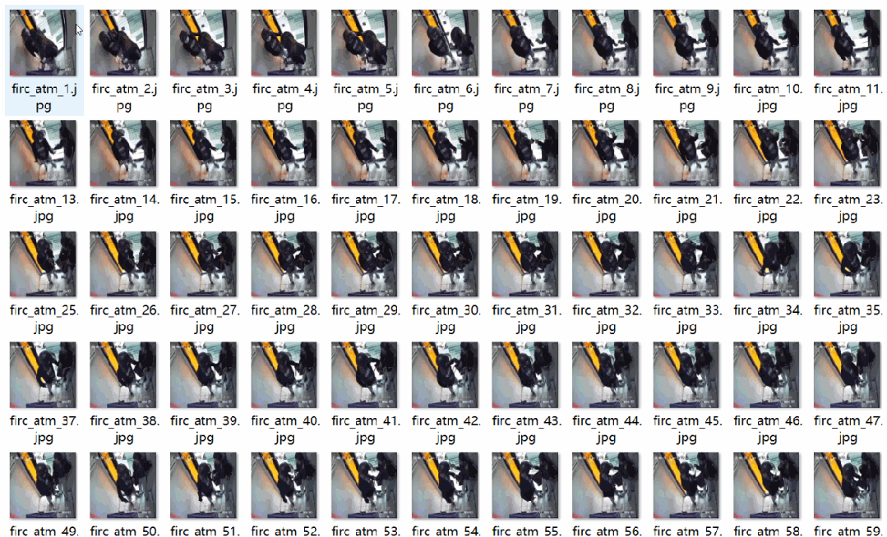
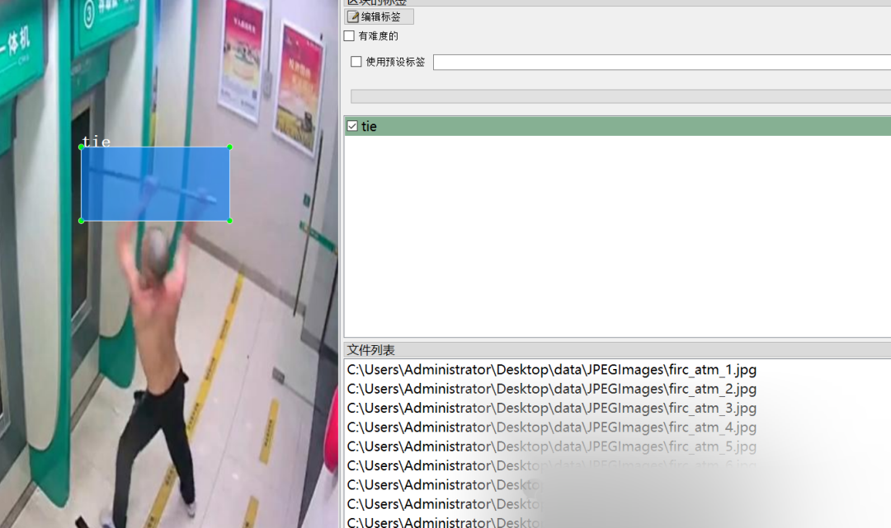

# ATM Machine Nearby Dangerous Items Detection Dataset VOC+YOLO format with 1251 images in 5 categories

Important Notice: The dataset is derived from approximately 9 video clips, which seem somewhat repetitive. Please carefully review the image preview to confirm compliance before downloading.

Dataset format: Pascal VOC format + YOLO format (txt file without split path, only containing jpg images and corresponding VOC format xml files and yolo format txt files)
Number of images (number of jpg files): 1251
Number of annotations (number of xml files): 1251
Number of annotations (number of txt files): 1251
Number of annotation categories: 5
Annotation category names: ["dao", "qiang", "tie", "wuti", "zhongwu"]

Objects, heavy objects
Number of boxes labeled in each category:
Dao box count = 156
Number of frames = 129
Number of tie frames = 642
Wuti Frame Count = 234
Number of frames = 188
Total frame count: 1349
Using labelImg:
Annotation rules: Draw a rectangle around the category.
Image resolution: 640x640
Special : This dataset does not guarantee the accuracy or precision of the trained models or weight files. The dataset is provided with accurate and reasonable annotations only.

Image Preview:

Annotation example:

## Payment

Here is a pay link on Stripe ( https://buy.stripe.com/3cs8yP7sY87d0vu9AB ). Please contact me lonlonago@foxmail.com after funding $89, and I will send you a complete data files , thank you!

